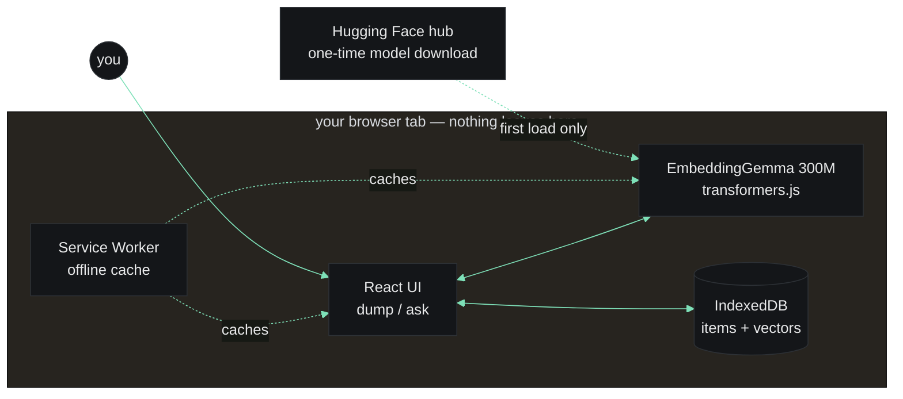

<div align="center">

# cubby

### Dump anything. Ask anything. Nothing leaves your device.

[](./LICENSE)
[](https://dev.to/events/challenges/hacktoberfest-week3-2026-10-19)
[](https://huggingface.co/onnx-community/embeddinggemma-300m-ONNX)
[](#contributing)

[**Live demo**](https://cubby.onrender.com) · [**DEV write-up**](./docs/DEV_POST.md) · [**Architecture**](./docs/ARCHITECTURE.md) · [**Honesty table**](./test/queries.md)

</div>

---

Everyone has the "I know I saved that somewhere" problem. You copy ~50 things a day and lose most of them — a wifi password, a `docker run` incantation, a flight number, that one address. Every notes app's fix is the same: *organize it*. Folders, tags, a system you abandon by week two.

**cubby asks for nothing.** Paste anything. One keypress. No folders, no tags, no title. Later, ask for it back in your own words — not the words you saved it with. An open-weight embedding model ([EmbeddingGemma](https://huggingface.co/onnx-community/embeddinggemma-300m-ONNX), 300M) runs entirely in your browser tab and ranks what you saved by meaning, offline.

---

## Features

- **Fully local.** Your dumps never touch a server. The model is a file the app downloads once (~300 MB) and runs in the tab. No account, no API key, no telemetry, no network call after first load — checkable in the network tab.
- **Semantic + lexical hybrid search.** `0.7 · cosine + 0.3 · lexical`, so a paraphrased query finds its target *and* an exact keyword never loses to a weak semantic guess. Measured recall@3 of **20/20** on a fixed test set vs. keyword's 14/20 — [full honesty table here](./test/queries.md).
- **Offline-first PWA.** Service worker caches the app shell + model weights; search keeps working on a plane.
- **Share-to-cubby.** On Android, the OS Share sheet writes straight into cubby — no app opening, no pasting. (iOS Safari's Web Share Target support is weak; see [RISKS.md R8](./docs/RISKS.md).)
- **Five themes × light/dark**, all WCAG AA–verified (`test/contrast.mjs`). Terminal / paper / mono / cobalt / ember.
- **Keyboard-first.** `Cmd/Ctrl+K` to focus, arrows to navigate, `Enter` to copy, `Esc` to clear. No mouse needed for the full dump → ask → copy loop.

## Try it

**Live:** <https://cubby.onrender.com>

Or run locally:

```bash
git clone https://github.com/ibrahim-iqbal/cubby.git
cd cubby
npm ci
npm run dev
```

Then open <http://localhost:5173>. First load downloads the model (~300 MB, one time, cached by the service worker thereafter).

Build + preview the production bundle:

```bash
npm run build
npm run preview
```

## How it works

Everything inside the dashed box lives on your device, forever:



Full detail: [ARCHITECTURE.md](./docs/ARCHITECTURE.md) (model choice, Matryoshka 256-dim truncation, hybrid-ranking math, failure/fallback ladder), [SPEC.md](./docs/SPEC.md) (features, flows, data shapes, acceptance criteria).

## Stack

- **UI:** React 19 + Vite + TypeScript, static site, no backend
- **Model runtime:** [`@huggingface/transformers`](https://github.com/huggingface/transformers.js) v3 (transformers.js) running [`onnx-community/embeddinggemma-300m-ONNX`](https://huggingface.co/onnx-community/embeddinggemma-300m-ONNX) with q8 quantization
- **Storage:** IndexedDB for items + 256-dim Float32 vectors; `localStorage` for settings (read before first paint to avoid theme flash)
- **Offline:** `vite-plugin-pwa` (service worker precaches shell + runtime-caches model weights)
- **Deploy:** Render static site — [`render.yaml`](./render.yaml) blueprint, no env vars needed

## Deploy your own

[`render.yaml`](./render.yaml) is a Render static-site blueprint: `npm ci && npm run build`, publish `dist`, SPA-rewrite every route to `index.html` (so `/share` and client routes work). On Render pick **New → Blueprint**, point at your fork, done. No environment variables, no secrets, no cost beyond Render's free static tier.

Any static host works — Netlify, Vercel, Cloudflare Pages, GitHub Pages (with a rewrite rule) — the build output is a plain `dist/` folder.

## Contributing

Issues and PRs welcome. The repo has a full planning trail if you want to read before contributing:

- [`docs/PLAN.md`](./docs/PLAN.md) — scope, non-goals, day-by-day plan, decisions log
- [`docs/SPEC.md`](./docs/SPEC.md) — features, user flows, data shapes, acceptance criteria
- [`docs/ARCHITECTURE.md`](./docs/ARCHITECTURE.md) — model, embeddings, storage, search pipeline
- [`docs/UI.md`](./docs/UI.md) — minimal + terminal aesthetic, 5 themes × light/dark, motion rules
- [`docs/RISKS.md`](./docs/RISKS.md) — risk register with mitigations and kill-switches
- [`test/queries.md`](./test/queries.md) — D4 recall measurement + honesty table

**Local setup:** standard Node 22+. `npm ci && npm run dev`.

**Verification scripts in `test/`:**

```bash
node test/contrast.mjs    # WCAG AA check across all 5 themes × 2 modes
```

For retrieval-quality checks, open the dev console in a running build and paste the small harness in `src/testdata/queries.mjs` (D4 honesty table).

**Guidelines:**
- Keep the "nothing uploaded" invariant honest. New features must not add outbound network calls at runtime (model fetch at first load is the only one, cached permanently thereafter).
- Changes to the ranking math must be measured against `test/queries.md`.
- All 5 themes × light/dark must pass WCAG AA (`test/contrast.mjs`).

## Honest limits

(Stated plainly, same as in the DEV post.)

- **No image/OCR capture** — text only, by design for v1.
- **No sync across devices.** JSON export/import is the only portability — there's no server to sync through.
- **Hybrid ranking narrows but doesn't erase** cases where the semantic and lexical signals disagree. Shown as a known behavior, not hidden.
- **The honesty table is 20 items** — it's the fixed set this project commits to re-running, not a claim the ceiling is infinite.
- **iOS Share-to-cubby is unreliable** (Web Share Target support is weak on Safari). Falls back to manual paste; stated outright rather than implied.

## Acknowledgements

- **[EmbeddingGemma](https://huggingface.co/onnx-community/embeddinggemma-300m-ONNX)** by Google — the model that makes this whole thing possible.
- **[transformers.js](https://github.com/huggingface/transformers.js)** by Hugging Face — in-browser ONNX runtime.
- **[Render](https://render.com)** — static hosting, zero config.
- **The Hacktoberfest Open-Source AI Challenge** — the forcing function.

## License

[MIT](./LICENSE).
