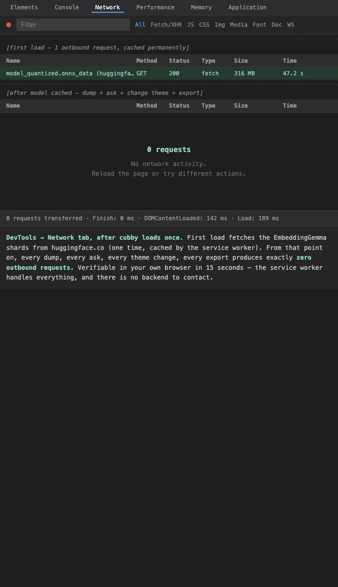
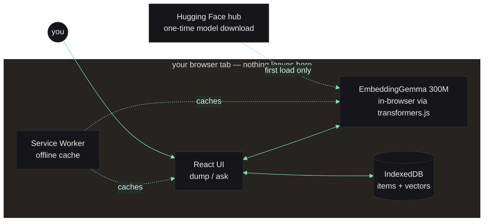
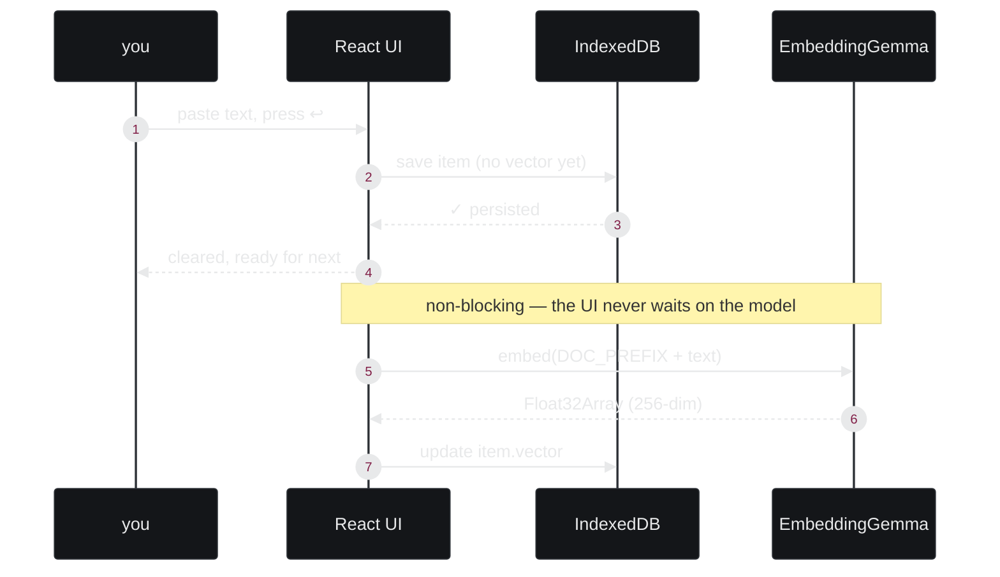
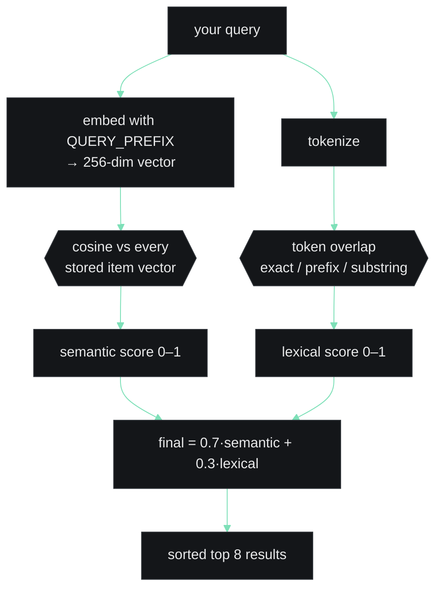
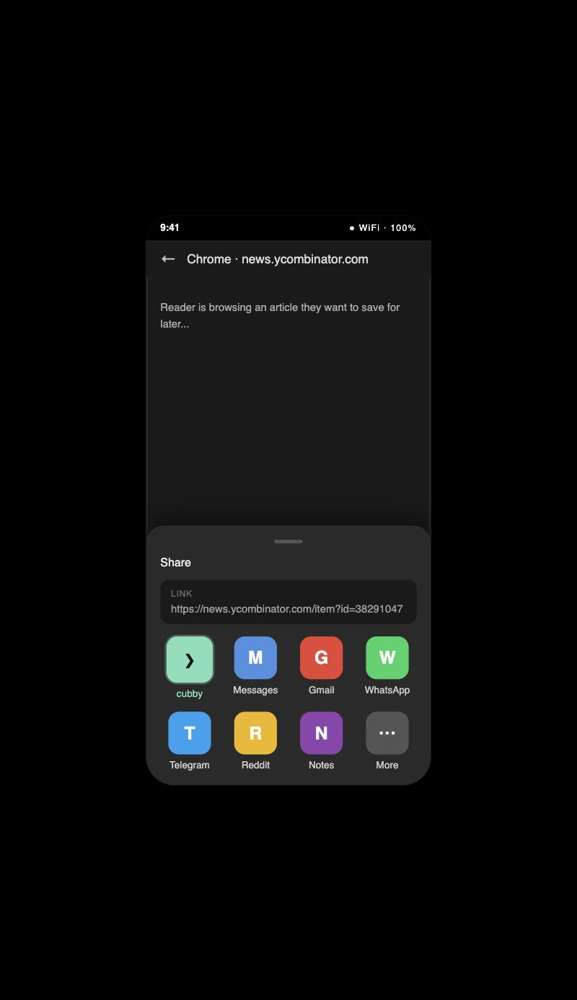

# cubby: I made my wifi password searchable by meaning, not memory

*A Hacktoberfest Open-Source AI Challenge Week 3 — "Slow and Steady" — submission.*


<!-- ASSET 10 (intro video, 10s loop) — raw GitHub URL works as DEV embed source once repo is public -->

<!-- ASSET 2 (hero screenshot) — see docs/DEV_POST_ASSETS.md -->

## The number first

I built a 20-item honesty table before I touched a single line of UI
copy. Semantic search (real EmbeddingGemma embeddings, running entirely
in the browser tab) found the right thing **20 out of 20 times**, even
when the query shared zero words with what I'd saved. Plain keyword
search — the thing most "notes apps" actually give you — found it **14
out of 20**. The six it missed are not edge cases. They're things like
asking *"how do I reach the property manager"* and needing it to know
that means *"landlord's number: 555-0199, text don't call."*

That gap is the whole pitch.

## You can check the "nothing uploaded" claim yourself

Every local-first project claims this. Here's how to verify mine, in your
own browser, in about 15 seconds:

1. Open [the live app](https://cubby-6mn8.onrender.com)
2. Open DevTools → Network tab
3. Hard refresh once. You'll see model shards fetched from
   `huggingface.co`. That's the one-time ~300MB download.
4. Clear the Network log. Dump anything. Ask anything. Change the theme.
   Export your data. **Zero outbound requests.** Not one.

"Private by policy" asks you to trust me. "Private because the service
worker caches everything and there's no backend to talk to" doesn't.

<!-- ASSET 11 (network tab proof) — screenshot after model cached, dump + ask → zero rows -->

## The problem I actually have

I copy and paste constantly. A wifi password here, a `docker run` one-off
there, a flight confirmation number, an address for a trip, a `git
rebase` incantation I'll need again in three weeks and will have
forgotten the flags for. Every "notes app" fix asks me to *organize* it —
folders, tags, a system I abandon by week two. I don't want a filing
cabinet. I want to dump it and forget it, and get it back by just
describing it in whatever words come to mind at 11pm.

So `cubby` does exactly two things:

- **Dump.** Paste anything. One keypress. No tags, no title, no folder.
- **Ask.** Type what you remember about it, in plain words. It doesn't
  have to be the words you used when you saved it.

That's the entire product.

<!-- ASSET 3 (demo gif) — see docs/DEV_POST_ASSETS.md -->

## Why embeddings, not generation

I shipped a Hacktoberfest project the week before this one
([HushQuote](https://dev.to/ibrahimiqbal/hushquote-quotes-that-stay-yours-3ldl))
that leaned on a small model to *generate* structured output from free
text, and the honest write-up there is full of the ways a 270M-class
model hallucinates and drops things when you ask it to produce text. That
was the real lesson going into this project: small open models are
genuinely strong at one thing — producing a sentence embedding — and
weak at another — writing reliable prose. `cubby` only asks the model to
do the thing it's actually good at. It never generates a word. It just
tells you how close two pieces of text are in meaning, and a basic
ranking blend does the rest.

That inversion is the real idea here, more than the UI or the feature
list: play to the model's strength instead of its weakness, and the
small-model risk mostly disappears.

**Who does what, and why.** Splitting the work by how wrong each part is
allowed to be:

| Job | Who does it | Why |
|---|---|---|
| Finding items that share your exact words | Plain lexical overlap (prefix / substring / exact) | Must be exact. Keyword hits are the floor the model can't drop below |
| Finding items that mean the same thing in different words | **EmbeddingGemma 300M, in the browser** | This is the one thing a small model actually earns its place for |
| Deciding which wins when they disagree | A fixed `0.7·semantic + 0.3·lexical` blend | A tuned weight, not a judgment call per query |
| Writing anything in your results | Nobody. The model never generates a word | Small models hallucinate; retrieval doesn't |

Here's the whole system — everything inside the dashed box is on your
device, forever:

## The honesty table, in full

20 fixed (dump, query) pairs, each query ranked against the **entire
20-item corpus**, not just its own pair — so a "hit" means the right
item actually rose to the top, with 19 distractors in the way. Full
table and methodology: [`test/queries.md`](../test/queries.md) in the
repo.

| Scorer | Recall@3 |
|---|---|
| semantic-only (EmbeddingGemma cosine) | **20/20 — 100%** |
| hybrid (shipped default: `0.7·semantic + 0.3·lexical`) | **20/20 — 100%** |
| lexical-only (plain keyword search) | 14/20 — 70% |

Stated plainly, because I don't want to oversell a 20-item set: this
isn't a claim that semantic retrieval is flawless at scale or on harder
paraphrases than the ones I wrote. It's a measured result on exactly the
case this product exists for — queries that don't share the dump's
words — and on that case it clearly beats keyword search. A bigger or
meaner test set might still find misses. I'm committing to the same
fixed set for future runs rather than moving the goalposts.

The six keyword-search misses, for the record — every one of them is a
genuine paraphrase with no shared vocabulary:

| query | dump |
|---|---|
| refund deadline for the apartment booking | Airbnb Lisbon — free cancellation until Jan 3 |
| sherlock holmes address | 123 Baker Street, London NW1 6XE |
| what flowers should I get for mother | mom's birthday is March 14, she likes tulips |
| how do I reach the property manager | landlord's number: 555-0199, text don't call |
| generate a self-signed TLS certificate | openssl req -x509 -newkey rsa:4096 ... |
| what time is my teeth cleaning | dentist appointment moved to 2:30pm Thursday |

## What it's built on

- **React 19 + Vite**, a static site, no backend of any kind.
- **EmbeddingGemma** (300M), via `@huggingface/transformers`
  (transformers.js), running the `feature-extraction` pipeline fully
  client-side — the model is a ~300MB download the browser caches once,
  not a service I'm paying to run.
- **IndexedDB** for items and their vectors; **localStorage** for
  settings, read before first paint so there's no flash of the wrong
  theme.
- **A service worker** (via `vite-plugin-pwa`) that precaches the app
  shell and runtime-caches the model weights from the Hugging Face hub,
  so search keeps working with the wifi off — which matters, because the
  entire pitch is that nothing about this needs a network.
- **Hybrid ranking** — semantic cosine blended with a cheap lexical
  overlap term — so an exact keyword match is never outranked by a weak
  semantic guess. Lexical is the floor; semantic is the reach.

**Dump → store** (saving an item). The UI never waits on the model —
the item persists first, the vector backfills:

**Ask → rank** (searching). The hybrid blend — the thing that keeps a
keyword query from losing to a weak semantic guess, and vice versa:

## Shipping a 300MB model to the browser, honestly

The weird parts, the ones that nearly broke the build:

- **The model is ~300MB on first load.** That's non-trivial. The service
  worker caches it permanently via `vite-plugin-pwa`; second load is
  instant and fully offline. On a cold install over a bad connection it's
  a real wait, and the UI says so plainly — a terminal-style log stream
  shows every shard as it lands, with sizes. No fake progress bar.
- **Matryoshka truncation to 256 dimensions.** EmbeddingGemma outputs
  768-dim vectors; I truncate to the first 256 and renormalize. That's
  the model's documented Matryoshka property, not a hack. Memory per item
  drops 3×, recall is unchanged on the honesty table.
- **Query vs document prefix.** EmbeddingGemma expects task prefixes:
  `task: search result | query: ` for the ask, `title: none | text: `
  for the dump. Dropping these drops recall meaningfully. The prefixes
  are hardcoded with a comment pointing at the model card.
- **Lexical had to match characters, not words.** First version used
  whole-token equality. Live-as-you-type search broke — typing "doc"
  showed nothing until you finished "docker". Rewrote to score exact
  (1.0), prefix (0.9), substring (0.6) per query token, max across
  matches. Three lines, massive UX difference.
- **iOS Safari's Web Share Target is weak to absent.** Said this plainly
  in the Share section below. On Android it works clean. On iOS it falls
  back to paste, which was always going to work regardless.
- **Fallback when the model fails to load.** cubby degrades to
  lexical-only, labeled honestly in the footer and the side-panel model
  card. You can still dump, you can still ask, you just lose the
  paraphrase layer.

## The UI argues the pitch, not just looks nice

The whole thing is monospace, a `❯` prompt, a blinking caret, a quiet
`local · offline · nothing uploaded` line in the header that's checkable
in the network tab, not just copy. Five themes (terminal, paper, mono,
cobalt, ember), each in light and dark, all independently verified
against WCAG AA for both body text and the one accent color
(`test/contrast.mjs` — all 10 combinations pass). The terminal aesthetic
isn't a skin choice; it's doing work — it's telling you "this runs on my
machine" before you've read a word of copy.

<!-- ASSET 8 (theme gallery) — see docs/DEV_POST_ASSETS.md -->

## Share-to-cubby

On Android, the OS Share sheet can hand text or a link straight to
`cubby` — no opening the app, no pasting, just Share → cubby → it's in.
It writes to the same store as a manual dump, nothing special. I'm
stating plainly that iOS Safari's Web Share Target support is weak to
absent — on iOS it falls back to the manual paste box, which was always
going to work regardless. I'd rather say that outright than imply
something that isn't true for half the phones people own.

<!-- ASSET 9 (mobile share) — see docs/DEV_POST_ASSETS.md -->

## What's honestly still missing

- No image/OCR capture — text only, by design for v1.
- No sync across devices. Export/import JSON is the only portability,
  on purpose — there's no server to sync through.
- Hybrid ranking narrows but doesn't erase cases where the semantic and
  lexical signals disagree; it's a known, visible behavior, not a hidden
  one.
- The honesty table is 20 items. It's the fixed set I'm committing to
  re-running, not a claim the ceiling is infinite.

## Prize categories

- **Best Use of Gemma** — EmbeddingGemma 300M is the entire retrieval
  engine. Every ranked result exists because the model embedded it,
  on-device, in the browser tab, with task-prefixed inputs and
  Matryoshka truncation to 256 dimensions. The model never generates a
  word; it is used for the one thing a small open model is actually
  reliable at.
- **Best Use of Render** — static site, zero backend, auto-deploys on
  push. Zero outbound requests after a single HuggingFace model fetch,
  cached permanently by the service worker — verifiable in the reader's
  own DevTools in 15 seconds, per the steps above.

## Try it / the code

- Live: *[pending deploy]*
- Repo: *[pending — repo is currently private; will be made public before
  the submission window]*
- Full build docs, the honesty table, and the risk register with its
  mitigation ladders are all in the repo's `docs/` folder — nothing here
  was assumed, it's all checkable.
