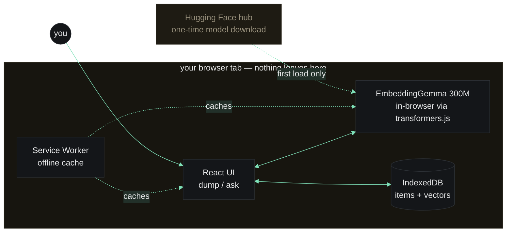
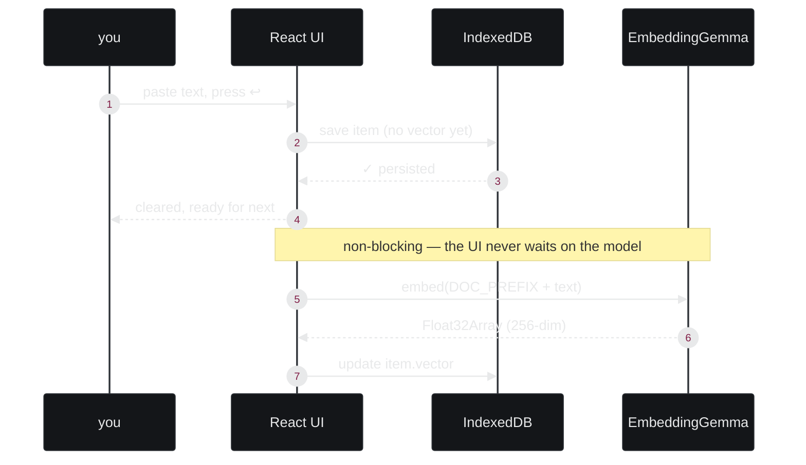
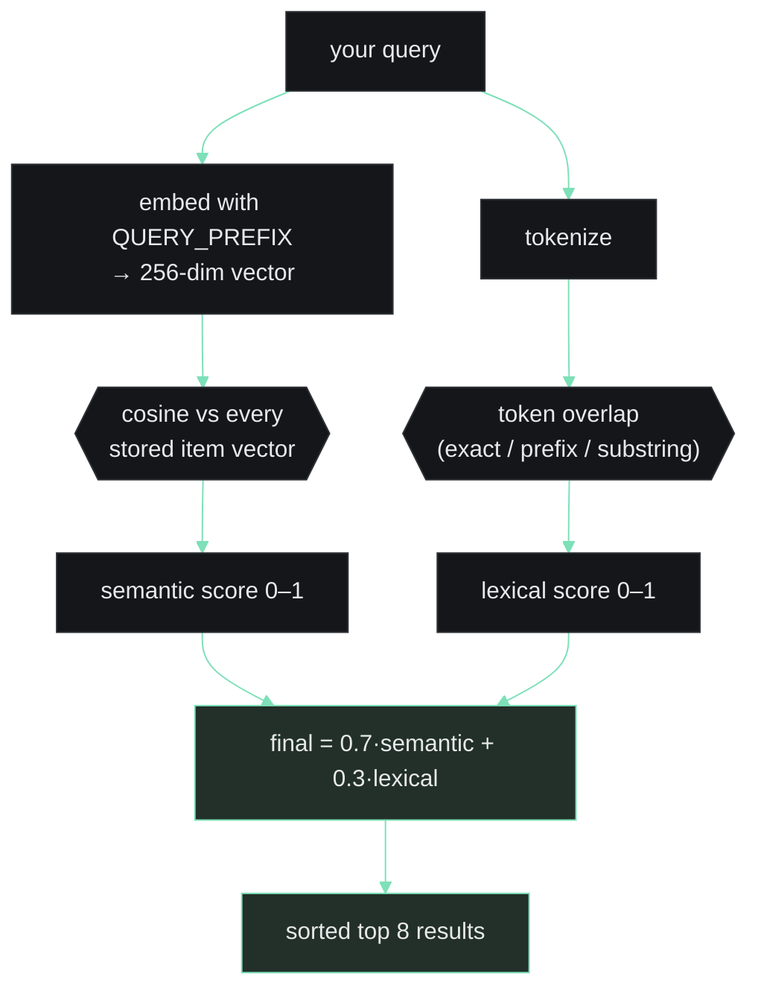
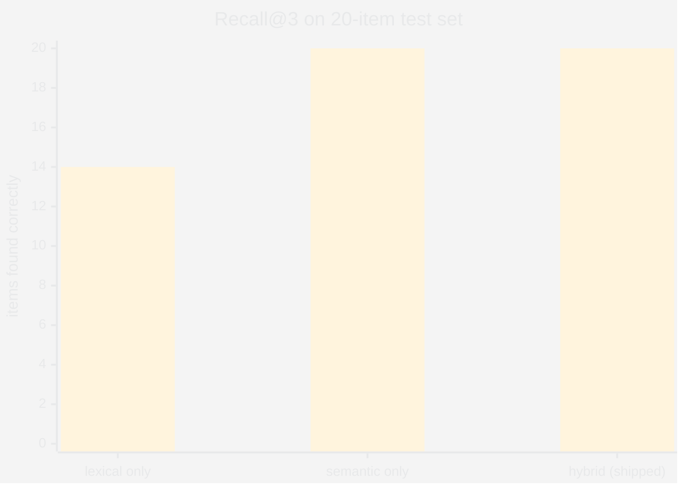

# cubby — DEV post asset brief

Everything the DEV post needs, split by where it comes from:
- **Gemini / Argon**: generated images + optional short video.
- **Screen capture (you, on the running app)**: real UI, no generation.
- **Mermaid diagrams**: in this file; GitHub + DEV both render them inline.

Order matches where each asset should land in `docs/DEV_POST.md`.

---

## 1. Cover image (DEV cover: 1000 × 420 px, horizontal)

**Source: Gemini (image).** Biggest conversion lever on DEV.to — a strong cover doubles clicks.

### Gemini prompt (paste verbatim)

```
A 1000x420 horizontal cover illustration for a developer blog post.
Flat, minimal, terminal-aesthetic. Dark charcoal background (#0e0f11).
Centered motif: a grid of small square compartments (a "cubby" / wall of
mail-slots), each slot a different shade of warm neutral, with 2–3 slots
glowing softly in a muted phosphor-green (#7ee0b8) — as if "lit up" by
retrieval. One slot has a tiny monospace "❯" prompt glyph in it.
Lower-left corner: the word "cubby." in a monospace font, same green.
No glossy effects, no gradients, no 3D, no AI-generated-photo vibe.
Looks like a thoughtfully-made editorial illustration for a programming
magazine — think Nicholas Felton, Edward Tufte, Monocle. Negative space
on the right half for the post title to overlay later.
```

**File name when saved:** `docs/design/post/cover.png`

---

## 2. Hero screenshot — the running app, ask mode with real results

**Source: you (screen capture).**

Steps:
1. Open http://localhost:5174 (or the deployed URL once Render is up).
2. Load a mixed cubby (notes + links + commands + addresses). Use the sample seeder from the dev console, or dump 6–8 real items.
3. Theme: **terminal / dark** (highest contrast, matches cover).
4. Type a paraphrase query like `refund deadline for the apartment` so the Airbnb/Lisbon match ranks top with a visible left-edge accent bar.
5. Hover the cursor somewhere in the empty right gutter so the spotlight glyph grid is visible on one side.
6. Capture at a wide viewport (≥ 1280px) so the gutter effect reads.

**File name:** `docs/design/post/01-hero.png`

---

## 3. Demo GIF — the complete loop in ~5 seconds

**Source: you (screen capture, convert to GIF).**

Sequence to record:
1. Start on an empty cubby, dump mode (bar is dump + tint, prompt is `+`).
2. Paste one item ("wifi password: Sunflower92"), press Enter → row collapses in with glyph.
3. Dump a second item ("Airbnb Lisbon — free cancellation until Jan 3"), press Enter.
4. Switch to ask mode (bar swaps to `❯`, lose the tint).
5. Type `refund` → the Lisbon row rises to top with its score bar at full height.
6. Press ↩ → "✓ copied" flashes on the source line.

Total: 5–7 seconds. Export as a looping GIF, ~800px wide, optimize to < 2MB (gifski or ezgif).

**File name:** `docs/design/post/02-loop.gif`

---

## 4. Architecture diagram — what's on-device vs. what isn't

Mermaid, inline in the post. Explains the "nothing uploaded" claim visually.



---

## 5. Dump → store pipeline

Mermaid, inline in the post. Shows that save never blocks on the model (the embed is async / backfilled).



---

## 6. Ask → rank pipeline (hybrid blend)

Mermaid, inline in the post. The money shot — explains the 0.7 / 0.3 blend.



---

## 7. Honesty-table comparison (semantic vs hybrid vs keyword)

Already a markdown table in the post — no image needed. If you want a chart instead, use this:



---

## 8. Theme gallery — 5 themes side-by-side

**Source: you (screen capture, 5 shots stitched).**

For each theme (terminal, paper, mono, cobalt, ember):
1. Open settings, pick the theme.
2. Capture the UI with the same mixed cubby loaded, in the same ask-mode state.
3. Export each at the same resolution.

Stitch into one 2 × 3 (or 1 × 5) grid using any image editor — Preview on macOS, Figma, Photopea.

**File name:** `docs/design/post/03-themes.png`

---

## 9. Mobile Share-to-cubby — real device

**Source: you (phone screen capture).**

Steps (Android, since iOS Safari's Web Share Target is unreliable — call this out in the caption):
1. Install cubby as PWA on an Android device.
2. Open any article (Chrome, Reddit, wherever).
3. Hit system Share → cubby should appear in the sheet.
4. Capture the share sheet with cubby visible.
5. Capture cubby's recent list with the new item at top.

**File names:** `docs/design/post/04-share-sheet.png`, `04-share-landed.png`

---

## 10. Optional — Gemini-generated short intro video (10 s)

Only if you have time. A looping explainer-animation that opens the post, replacing the static cover.

### Gemini prompt (paste verbatim)

```
A 10-second looping video, 1280x720, 30fps. Minimal, dark terminal
aesthetic. The sequence:
0–2 s: an empty 4×3 grid of small square compartments on a dark
charcoal (#0e0f11) background slowly materializes, line-art only, no
fill.
2–5 s: words appear one at a time inside different compartments in a
muted phosphor-green monospace font — "wifi password", "docker run",
"Lisbon jan 3", "mom tulips". Short, overlapping, casual.
5–8 s: a prompt character "❯" appears below the grid; next to it the
text "refund deadline?" types out, then one of the compartments
("Lisbon jan 3") glows and lifts slightly.
8–10 s: the lifted word slides out and the loop restarts.
No sound. No camera motion. No glossy effects, no particles. Looks like
a thoughtful motion-graphics explainer, not a product promo.
```

**File name:** `docs/design/post/00-intro.mp4` (and `.webm` for compat)

---

## Where each asset lands in the post

| Asset | Section of `DEV_POST.md` |
|---|---|
| 1. Cover | DEV cover image slot (uploaded separately when publishing) |
| 2. Hero screenshot | immediately under the H1, before "The number first" |
| 3. Demo GIF | under "The problem I actually have" |
| 4. Architecture diagram | under "Why embeddings, not generation" |
| 5. Dump pipeline | under "What it's built on" |
| 6. Ask pipeline | under "What it's built on", after dump |
| 7. Recall chart (optional) | under "The honesty table, in full" |
| 8. Theme gallery | under "The UI argues the pitch" |
| 9. Mobile share | under "Share-to-cubby" |
| 10. Intro video (optional) | top of post, as embed |

---

## Pre-publish checklist

- [ ] Cover generated (asset 1)
- [ ] Hero + demo GIF captured on the deployed URL (assets 2, 3)
- [ ] Mobile shots captured on real Android (asset 9)
- [ ] Theme gallery stitched (asset 8)
- [ ] All images added to `docs/design/post/` and referenced in `DEV_POST.md`
- [ ] Live Render URL filled into the "Try it / the code" section
- [ ] Repo made public, link filled in
- [ ] Prize categories (Best Use of Gemma, Best Use of Render) tagged on the DEV draft
